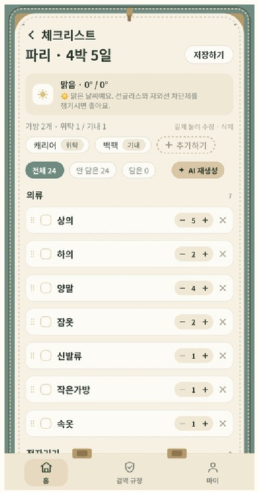
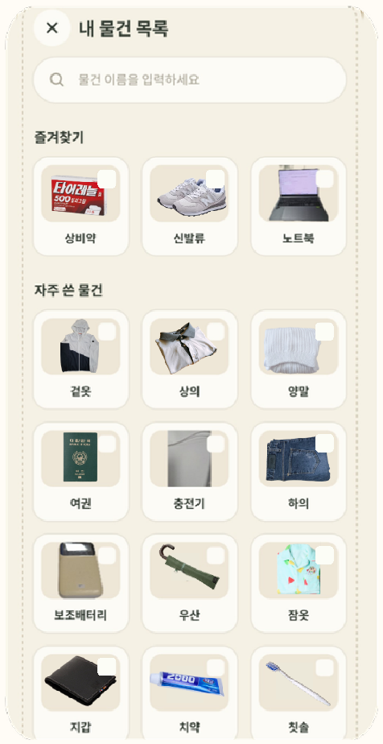
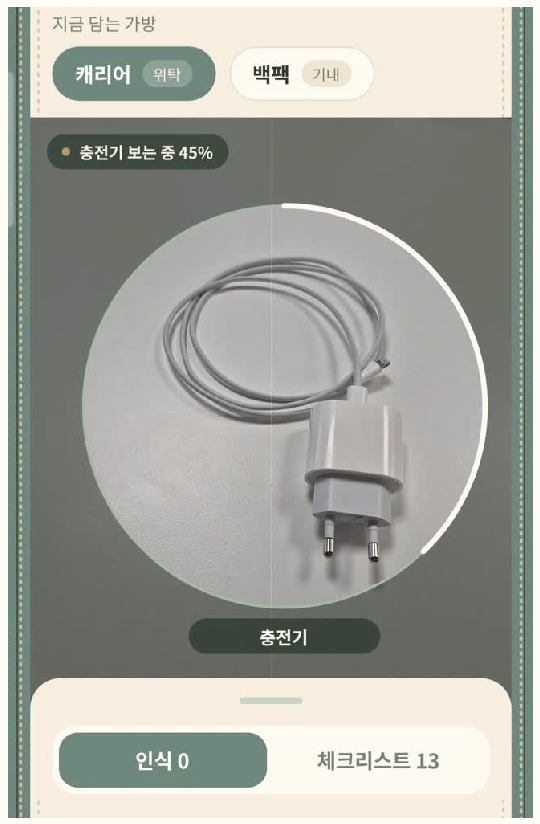
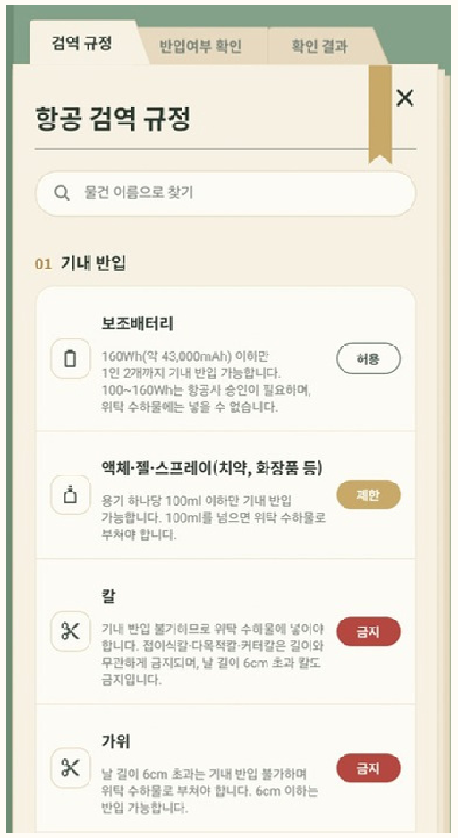
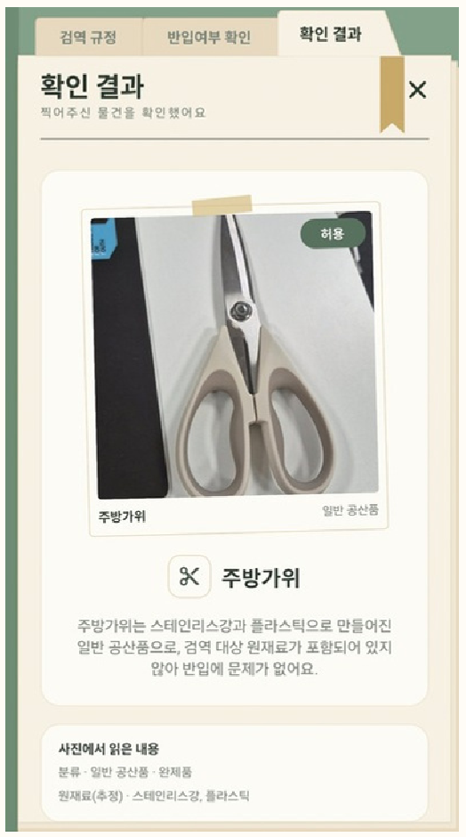
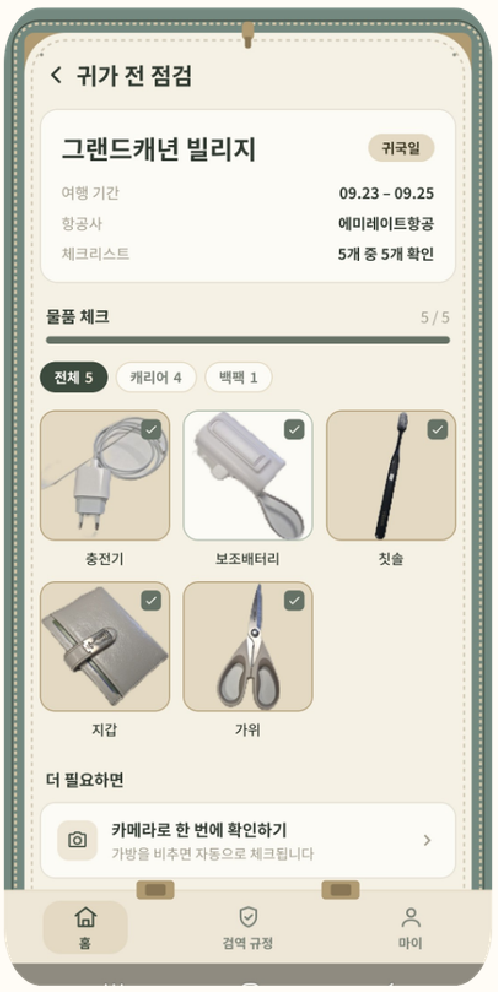
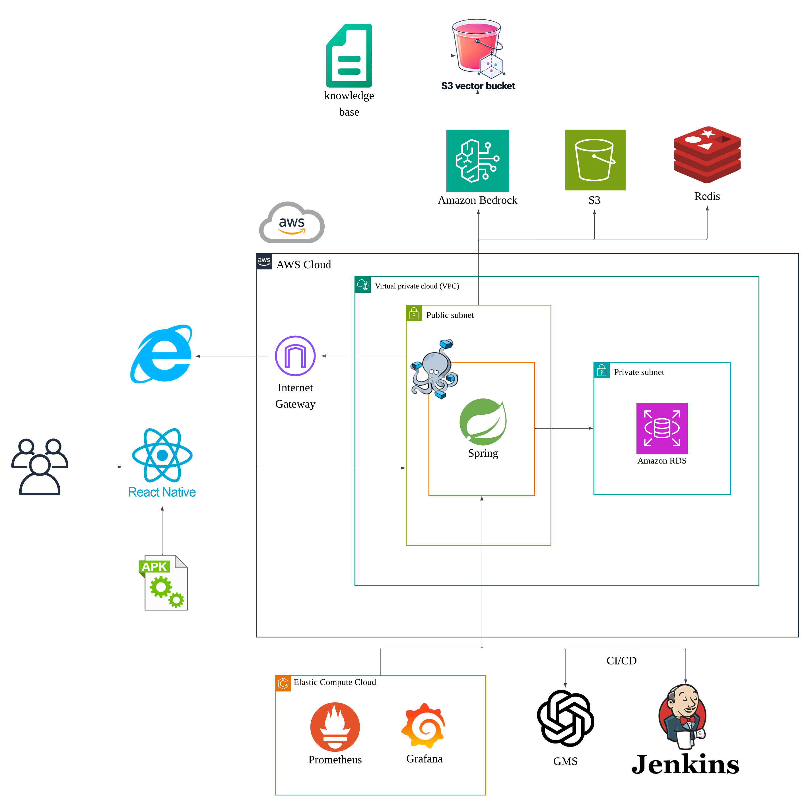
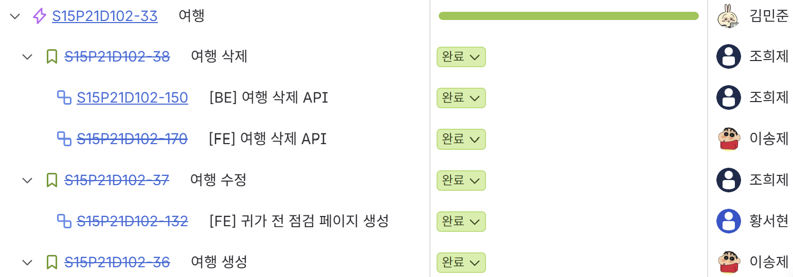

# 🧳 CheckMate — AI 기반 여행 짐 싸기 도우미

> 카메라로 짐을 싸고, AI가 기내·위탁 반입 규정까지 확인해 줍니다.

여행지와 일정에 맞춘 AI 체크리스트를 만들고, 카메라로 비춘 물건을 **온디바이스 AI**로 인식해 가방에 담으며, **RAG 기반 반입 규정 검사**로 출국 전 짐을 점검하는 모바일 서비스

**담당 역할** — 백엔드 전반과 인프라를 담당했습니다.

---
## 💡 기획 배경

- 해외여행 출국자 수 2,900만 명(2025년)으로 해외여행이 다시 일상이 되었습니다.
- 여행자 111명 대상 설문 결과, **82%** 가 물품을 챙기지 않아 현지에서 구매한 경험이 있고, **62%** 가 기내 반입·국내 반입 여부를 고민했습니다.
- 짐 체크리스트, 항공 반입 규정, 검역 규정이 모두 흩어져 있어 여행자가 직접 찾아봐야 했고, CheckMate는 이를 **하나의 서비스**로 묶었습니다.

---
## 🚀 주요 기능

| AI 체크리스트 추천 | 내 물건 불러오기 | 실시간 물건 인식 |
| :---: | :---: | :---: |
|  |  |  |
| 날씨·목적지·활동을 바탕으로<br>AI가 준비물 체크리스트 추천 | 즐겨찾기·자주 쓴 물건을<br>체크리스트에 바로 추가 | 카메라에 비추면 온디바이스 AI가<br>물건을 인식해 선택한 가방에 담기 |

| 항공 반입 규정 | 반입·검역 판정 | 귀가 전 점검 |
| :---: | :---: | :---: |
|  |  |  |
| 규정 안내를 통해 물건별<br>위험·제한·허용 확인 | 물품을 촬영하면 AI가<br>반입 가능 여부와 근거를 판정 | 귀가 전, 챙겨 간 짐과 비교해<br>빠뜨린 물건 점검 |

---
## 🛠️ 기술 스택

### Frontend
| 기술 | 사용처 |
| --- | --- |
| React Native 0.86 + Expo 57, TypeScript | 모바일 앱 개발 |
| Expo Router, Zustand, TanStack Query, NativeWind | 화면 라우팅, 전역 상태 관리, 서버 데이터 캐싱, 스타일링 |
| react-native-vision-camera + react-native-fast-tflite | 카메라 프레임을 받아 온디바이스로 물체 인식 |

### Backend — 이 저장소
| 기술 | 사용처 |
| --- | --- |
| Java 21, Spring Boot 4.1.1 (MVC, Data JPA, Validation) | API 서버 전반 |
| MySQL 8.0 (운영), H2 (로컬) | 회원·여행·체크리스트·가방 데이터 저장 |
| JWT(jjwt 0.13), Google ID Token | Google 소셜 로그인 및 API 인증 |
| AWS SDK — S3 | 여행 표지·물품 사진 업로드 |
| AWS SDK — Bedrock Agent Runtime / Runtime | 반입 규정 검사(RAG 검색 + LLM 판정)에 사용 |
| Open-Meteo, Google Places | 여행지 날씨 조회(체크리스트 추천), 목적지 자동완성 |

### AI
| 기술 | 사용처 |
| --- | --- |
| YOLO26n-seg | 여행용품 23개 클래스 물체 탐지 + 세그멘테이션 (실사진 정확도 34.2% → 83.2%) |
| TFLite | 모델 변환 후 앱에서 온디바이스 추론 (영상을 서버로 보내지 않아 프라이버시 보호) |
| Bedrock Knowledge Base + S3 Vectors + Titan Text Embeddings V2 | 항공보안·세관·검역 규정 문서를 임베딩해 반입 규정 검사 RAG에 사용 |
| Claude Haiku 4.5 (Bedrock) | 검색된 규정을 근거로 기내/위탁·입국 반입 가능 여부 판정 |
| Cohere Rerank 3.5 | 검역 규정 검색 결과 리랭크 — 입력 토큰 38.4% 절감 |

### Infra / CI-CD
| 기술 | 사용처 |
| --- | --- |
| AWS VPC, EC2, RDS(MySQL) | 서버·DB 운영 (DB는 Private Subnet에 배치) |
| SSM Parameter Store, CloudWatch Logs | 환경변수(시크릿) 관리, 서버 로그 수집 |
| Nginx + Let's Encrypt, Docker Compose | HTTPS 리버스 프록시, 컨테이너 배포 |
| GitLab CI | `develop` 브랜치 변경 시 EC2 자동 배포 |
| Firebase App Distribution, Expo EAS Update | 테스트 앱 배포, OTA 업데이트 |

---
## 🏗️ 시스템 아키텍처



1. **온디바이스 인식** — 카메라 프레임을 앱 안의 YOLO(TFLite) 모델로 인식해 서버 왕복 없이 물건을 판별
2. **반입 규정 검사(RAG)** — 물품 이름별로 Bedrock Knowledge Base를 검색하고, 검색된 규정을 근거로 Claude Haiku 4.5가 기내/위탁 반입 여부를 판정
   - 항공보안 규정(`avsec`) → 출국 짐 기내·위탁 판정
   - 한국 입국 세관·검역 규정(`import`) → 기념품 반입 판정 (Cohere Rerank로 검색 결과 리랭크)
3. **배포** — `develop` 브랜치 backend 변경 시 GitLab Runner가 SSM Parameter Store에서 `.env`를 만들고 `docker compose up -d --build`로 EC2에 배포

---
### 커밋 메시지 타입 프리픽스
| 타입 | Gitmoji | 용도 |
| --- | --- | --- |
| `feat:` | ✨ | 새 기능 추가 |
| `fix:` | 🐛 | 버그 수정 |
| `hotfix:` | 🚑 | 긴급 수정 |
| `refactor:` | ♻️ | 동작 변경 없는 리팩터링 |
| `docs:` | 📝 | 문서 변경 |
| `test:` | ✅ | 테스트 추가/수정 |
| `chore:` | 🔧 | 빌드, 설정, 패키지 수정 |

---
## Jira 활용 방식

### 이슈 계층 구조
`에픽(Epic) → 스토리(Story) → 하위 작업(Sub-task)` 3단계로 업무를 분해해 관리

- **에픽**: 기능 단위의 큰 묶음 (예: `반입 규정 검사`)
- **스토리**: 사용자 관점의 기능 (예: `기내·위탁 반입 판정`, `기념품 입국 판정`)
- **하위 작업**: 실제 구현 단위 작업 (예: `[BE] 반입 규정 검사 API 만들기`)

브랜치는 `{type}/{Jira 이슈키}-{작업명}` 형식으로 이슈와 연결 (예: `feat/S15P21D102-58-로그인`)



---
## 📦 폴더 구조

```text
checkmate/                  # Spring Boot API 서버
├─ src/main/java/ssafy/checkmate/
│  ├─ domain/
│  │  ├─ member/            # 회원, Google 로그인, 즐겨찾기·자주 쓰는 물건
│  │  ├─ trip/              # 여행 생성/조회, 목적지 자동완성(Google Places), 표지 사진
│  │  ├─ checklist/         # AI 체크리스트 추천, 가방, 인벤토리, 물품 스캔 등록, 귀가 전 점검
│  │  ├─ regulation/        # 기내·위탁 반입 규정 검사, 기념품 입국 판정 (Bedrock RAG)
│  │  └─ weather/           # 여행지 날씨 (Open-Meteo)
│  └─ global/               # auth(JWT) / config / exception / response / storage(S3)
├─ src/test/                 # 단위·통합 테스트
├─ docs/                     # 인증 등 설계 문서
├─ Dockerfile
└─ docker-compose.yml
```

## 📄 문서 / 트러블슈팅

- [인증 설계](docs/auth.md)
- [검역 규정 RAG에 Rerank 적용 — 판정 정확도 유지, 입력 토큰 38% 절감](docs/troubleshooting/quarantine-rerank.md)

## 👥 팀 소개

| 이름 | 역할 |
| --- | --- |
| 조희제 | Backend, Infra |
| 이송제 | FrontEnd, BackEnd |
| 황서현 | FrontEnd |
| 홍진규 | AI, FrontEnd |
| 김민준 | Backend |
| 박민정 | AI |
|  |  |
