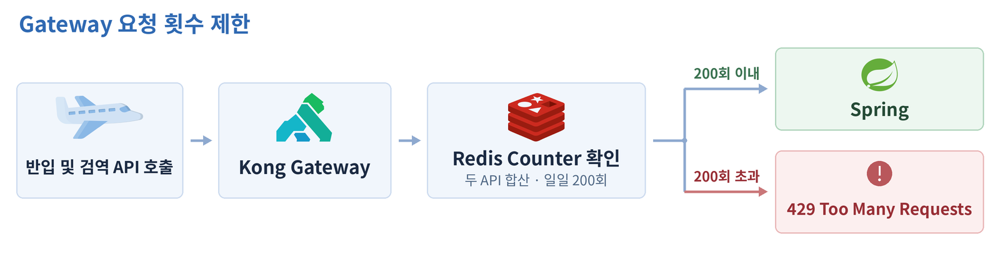
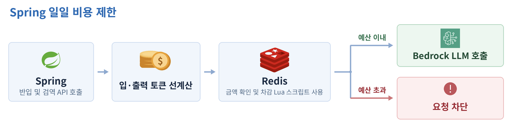

# 반입 및 검역 API 처리율 제한 장치 설계

## 문제 원인

항공기 반입 검사와 국내 검역 기능은 Bedrock을 통한 LLM 호출에 건당 약 50원의 비용이 발생합니다. 사용자가 기능을 반복해서 호출하면 일일 운영비를 예측하기 어려운 문제가 발생할 수 있습니다.

## 해결 과정

### Kong Gateway에서 일일 호출 횟수 제한

일일 예산 1만 원을 기준으로 두 API의 합산 호출을 **하루 200회**로 제한했습니다. Kong Gateway에서 Redis 카운터로 호출 횟수를 집계하고, 한도를 초과하면 `429 Too Many Requests`를 반환하도록 설정했습니다.

### AI 기능 내부에서 일일 비용 제한

LLM 호출 전 Bedrock `CountTokens` API로 입력 토큰 수를 계산하고, 출력 토큰 비용은 **허용한 가장 긴 응답의 토큰 수**를 기준으로 산정했습니다. 두 비용을 합산해 일일 누적 비용이 **1만 원을 넘을 것으로 예상되면 호출을 차단**했습니다.

Redis Lua 스크립트로 잔액 확인과 차감을 원자적으로 처리하여 동시성을 제어했습니다.

## 결과

일일 예산 초과가 예상되는 호출을 사전에 차단해, 정해진 운영 예산 안에서 여행자에게 항공기 반입, 국내 검역 안내를 지속적으로 제공할 수 있는 기반을 마련했습니다.
