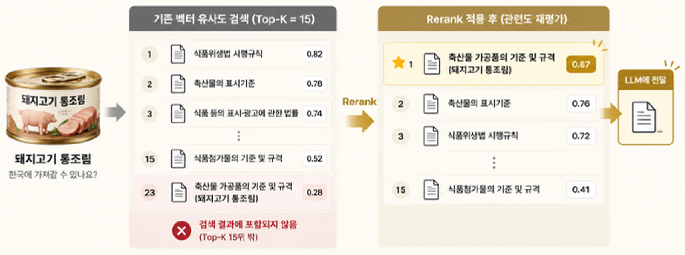
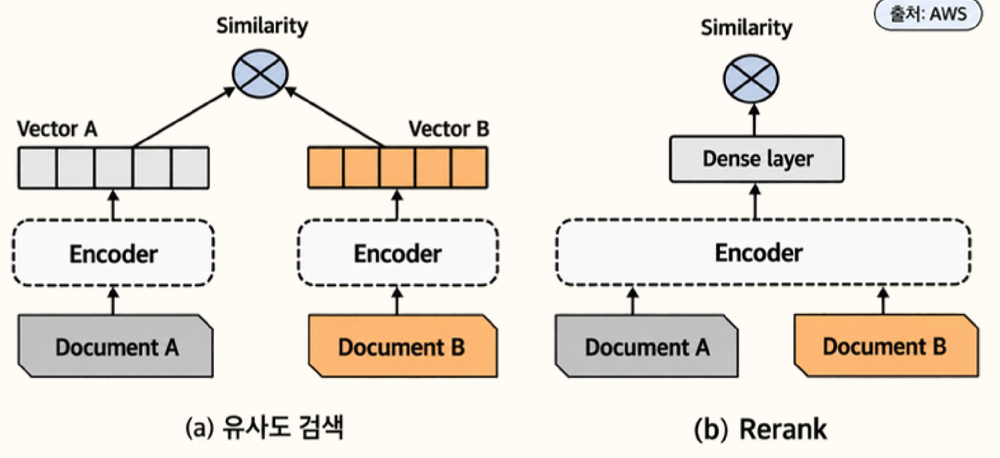

# Rerank 도입으로 검역 규정 검색 품질과 LLM 비용 개선

> 벡터 검색에서 핵심 규정이 누락되는 문제를 Rerank로 해결해, **판정 정확도를 유지하면서 LLM 입력 토큰을 38% 줄였습니다.**

## 배경

기념품 사진을 찍으면 VLM으로 물품의 종류와 상태를 판독하고, **한국 입국 검역 규정**을 RAG로 검색해 LLM이 `허용 / 제한 / 금지`를 판정하는 기능을 개발했습니다.

| 질의 | 예시 | 응답 예시 |
|---|---|---|
| 품목 질의 | `술은 한국에 들고 올 수 있나요?` | 국내 반입 규정<br>- 면세 용량: 총 2L 이하<br>- 면세 금액: 총 400달러 이하 |

이 구조에서는 LLM이 아무리 정확해도 검색 단계에서 올바른 규정을 가져오지 못하면 판정도 틀릴 수밖에 없습니다.

## 문제 상황

검색 품질을 검증하기 위해 여행자가 자주 들고 오는 물품 40종으로 골든셋을 만들어 Top-K 15로 실험했습니다.

그 결과 **소고기 통조림**의 판정에 꼭 필요한 조문인 *"5kg 이하 멸균처리 통조림"* 이 벡터 유사도 **23위**에 머물러 검색 결과에서 빠지는 것을 확인했습니다.



## 원인 분석

검역 문서에는 여행자 휴대품 규정과 컨테이너·항공화물 같은 **화물 수입 절차**가 함께 들어 있습니다.
두 문서 모두 "소고기", "통조림" 같은 단어를 공유하기 때문에, 단어 의미만 비교하는 벡터 유사도로는 **물품을 직접 다룬 조문과 단순히 같은 단어가 나오는 화물 절차를 구분하지 못했습니다.**

## 해결 과정

### 1차 시도: Top-K를 30으로 확장

가장 단순한 방법은 Top-K를 늘려 23위 조문까지 가져오는 것이었습니다.
하지만 골든셋으로 측정해 보니 관련 없는 화물 절차까지 함께 들어가 **건당 입력 토큰이 평균 18,371**까지 늘어났습니다.
LLM 비용의 대부분이 입력 토큰이고 물품마다 판정을 호출하는 구조라, 이 방식은 서비스 비용 부담으로 이어진다고 판단했습니다.

그래서 **더 많이 가져오는 대신, 가져온 것 중 정말 관련 있는 규정만 고르는 방법**을 찾았습니다.

### 2차 시도: Rerank 도입



벡터 검색은 질문과 문서를 각각 따로 벡터로 바꿔 비교하는 반면, Rerank는 **질문과 문서를 함께 입력해 관련도를 0~1 점수로 다시 매깁니다.**
덕분에 같은 단어만 공유하는 화물 절차보다 물품을 직접 다룬 조문에 더 높은 점수를 줄 수 있습니다.

후보는 넓게 가져오되 LLM에는 소수만 전달하도록 다음과 같이 구성했습니다.

```text
품목 질의 → 벡터 검색 Top-50 → Cohere Rerank 3.5 → 점수 0.25 이상 상위 5개 → LLM 판정
```

| 설정 | 값 | 근거 |
|---|---|---|
| 후보 수 | 50 | 23위처럼 낮은 순위의 조문도 Rerank 대상에 포함되도록 설정 |
| 점수 기준 | 0.25 | 골든셋 40종에서 판정에 필요한 핵심 조문이 모두 0.25 이상에 포함됨 |
| 전달 개수 | 상위 5개 | LLM 입력 토큰 최소화 |

## 결과

| 지표 (골든셋 40종) | Top-K 30 | Rerank 적용 |
|---|---|---|
| 판정 일치 | 40 / 40 | 40 / 40 |
| 놓침 (금지인데 허용) | 0 | 0 |
| **입력 토큰 (건당 평균)** | 18,371 | **11,313 (−38%)** |

- Top-K 30과 **동일한 판정 정확도를 유지하면서 입력 토큰을 38% 절감**했습니다.
- 판정 근거가 같은 단어만 공유하던 화물 절차에서 **물품을 직접 다룬 조문**으로 바뀌어, 사용자에게 보여주는 판정 사유의 신뢰도가 높아졌습니다.

## 배운 점

- 검색 결과를 늘리는 것만으로는 품질과 비용을 함께 잡을 수 없었습니다. **넓게 검색하고 정밀하게 고르는 2단계 구조**가 RAG에서 효과적이라는 것을 확인했습니다.
- 감으로 설정값을 정하지 않고 **골든셋으로 매번 같은 조건에서 비교**했기 때문에, Top-K와 점수 기준을 근거를 가지고 결정할 수 있었습니다.
